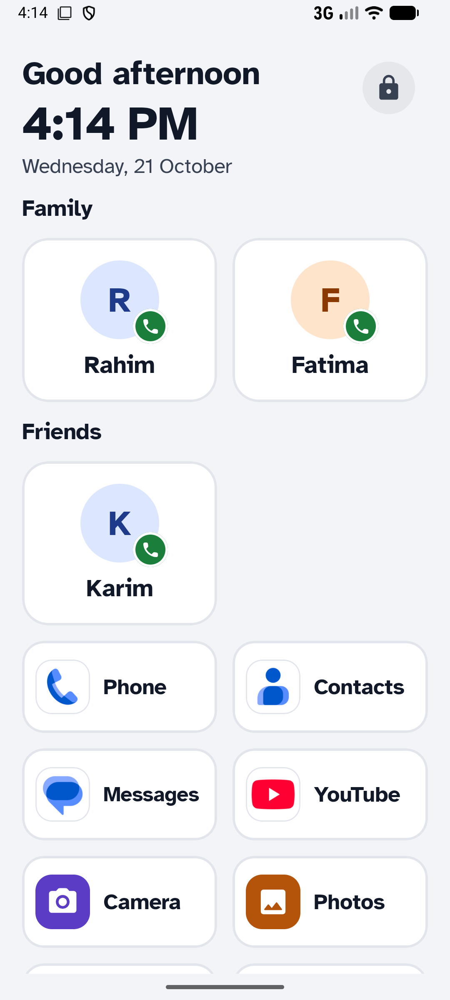
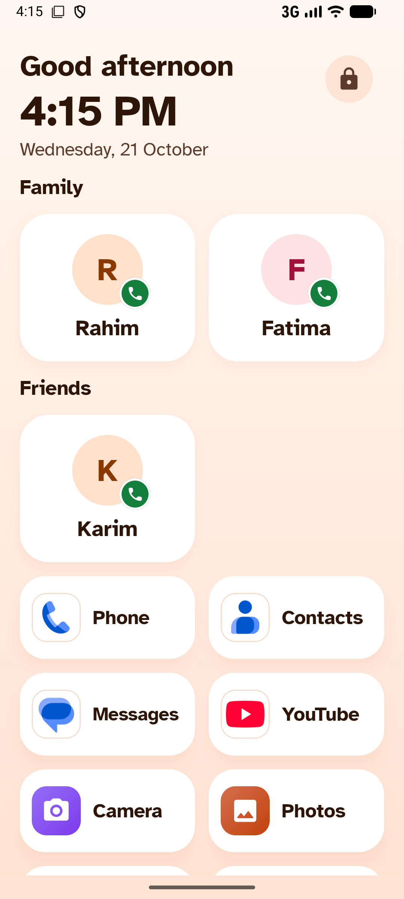
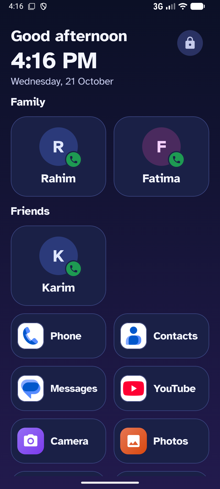
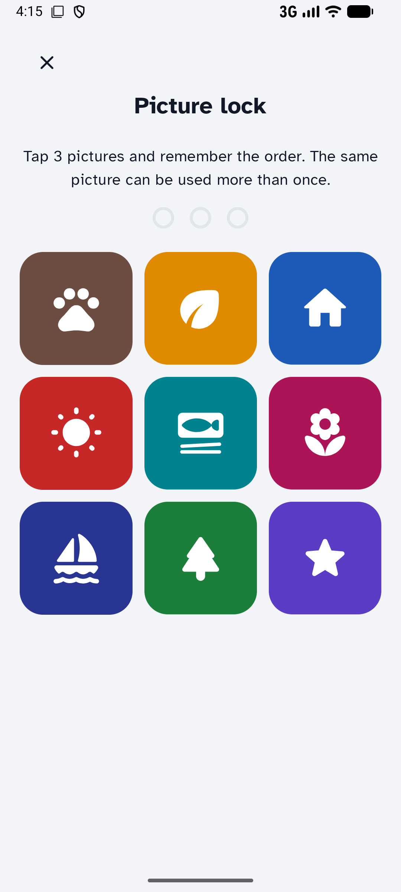
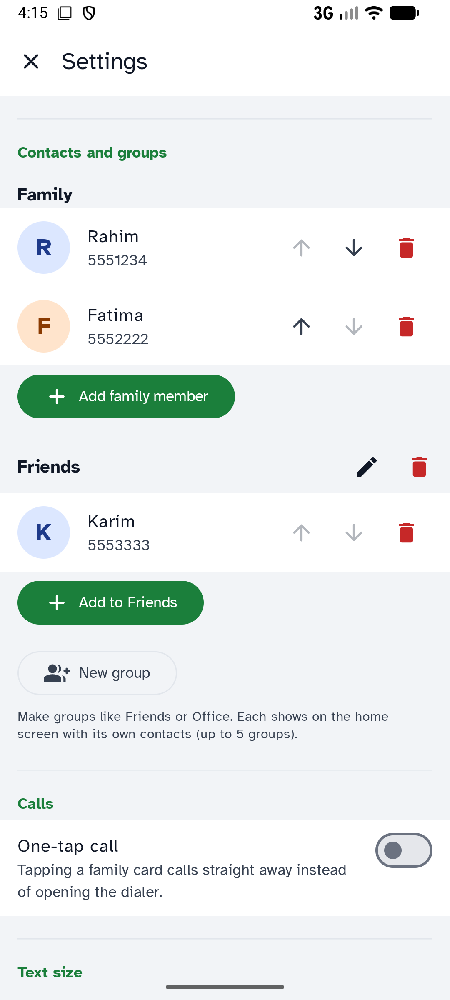
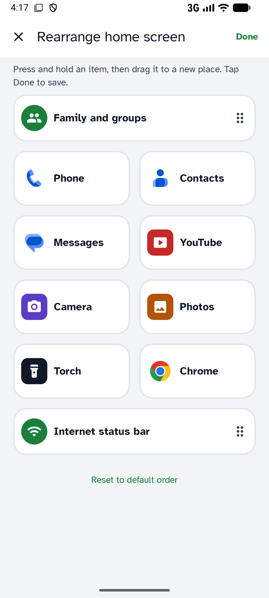
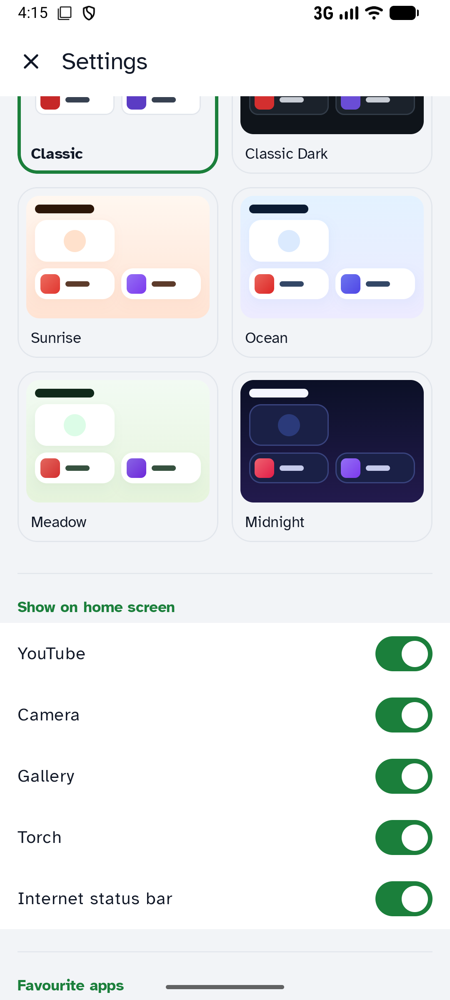

# Ek Chhoan (এক ছোঁয়া · एक छुअन)

**A simple, elder-friendly home screen (launcher) for Android.**

Ek Chhoan ("one touch") replaces a busy phone screen with one calm page an older person can use without reading or typing: big photos of family to call, big buttons for the apps they use, a clear clock, and an internet status bar that says in words, colour and icon whether the internet is working. A family member sets everything up behind a simple picture lock.

> **Developed by [PNT Apps](https://www.pntapps.com)**
> [Website](https://www.pntapps.com) · [About](https://www.pntapps.com/about) · [Privacy policy](https://www.pntapps.com/privacy) · [Terms of use](https://www.pntapps.com/terms)

---

## Screenshots

| Home (Classic) | Home (Sunrise) | Home (Midnight) |
|:---:|:---:|:---:|
|  |  |  |
| **Picture lock** (family only) | **Contacts and groups** | **Rearrange by drag and drop** |
|  |  |  |
| **Six themes** | | |
|  | | |

## Features

- **Big call cards** for family, plus custom groups (Friends, Office…). One tap opens the dialer, or calls directly when "one-touch calling" is allowed.
- **Calling and messaging apps first**: the phone's own Phone, Contacts, Messages and WhatsApp, found by role so they work on every brand.
- **Big tiles** for YouTube, Camera, Photos, Torch and up to 8 favourite apps (searchable picker).
- **Rearrange by drag and drop**: Settings → Home screen order shows Home as it looks; long-press and drag.
- **Large clock, greeting and date**, updated every minute.
- **Internet status bar**: Wi-Fi / mobile data / Wi-Fi without internet / offline, by colour, icon and words; tap to open the system internet panel.
- **Picture lock** (3 pictures, repeats allowed) protects Settings.
- **Six themes**: Classic (default), Classic Dark, Sunrise, Ocean, Meadow, Midnight.
- **Text size** and **icon size** (Normal / Large / Extra large), **icons with names or icons only**.
- **English (default), Bengali and Hindi**, with optional read-aloud in the chosen language.
- **Private by design**: no internet permission, no accounts, ads or analytics. All data stays on the phone.

## Requirements

- Android 8.0 (API 26) or newer. Targets API 36.
- To build: Android Studio (recent), JDK 17+, Android SDK with platform 37.

## Build

```bash
./gradlew :app:assembleDebug        # debug APK  → app/build/outputs/apk/debug/
./gradlew :app:testDebugUnitTest    # unit tests
./gradlew :app:lintDebug            # lint
./gradlew :app:bundleRelease        # release AAB (R8); signing via keystore.properties, see play/release-checklist.md
```

Every build runs `checkForbiddenPermissions<Variant>`, which fails if the merged manifest asks for any permission other than `ACCESS_NETWORK_STATE`, `ACCESS_WIFI_STATE`, `CALL_PHONE` or `VIBRATE`. That's deliberate: keep it that way so the app stays Google Play compliant and private.

Project notes for contributors (and AI coding assistants) are in [`CLAUDE.md`](CLAUDE.md). Google Play material (privacy text, Data safety answers, store listing, release checklist) is in [`play/`](play/).

## Credit to PNT Apps — required

If you use, fork, modify or redistribute Ek Chhoan, you **must keep the credit to PNT Apps**:

- in your README or main documentation: **"Developed by PNT Apps — https://www.pntapps.com"**, and
- inside the app, where users can see it (for example an About or Settings screen): **"Developed by PNT Apps"** linking to https://www.pntapps.com.

You may add your own credits next to it. This is an additional term of the license (GPL-3.0, section 7(b)); see [`NOTICE`](NOTICE).

A modified version must not be presented as the original Ek Chhoan, and the names "PNT Apps" and "Ek Chhoan" and their logos/icons may not be used as the name or icon of your app.

## License

Copyright © 2026 PNT Apps.

Ek Chhoan is licensed under the **GNU General Public License v3.0** ([`LICENSE`](LICENSE)) with the additional attribution terms in [`NOTICE`](NOTICE).

In short: you may use, study, change and share this app, but **if you distribute it or a modified version, you must release your source code under the same GPL-3.0 license** (including the attribution terms) and keep the credit to PNT Apps.

Bundled fonts are under the SIL Open Font License 1.1 and libraries under Apache 2.0; see [`NOTICE`](NOTICE).
